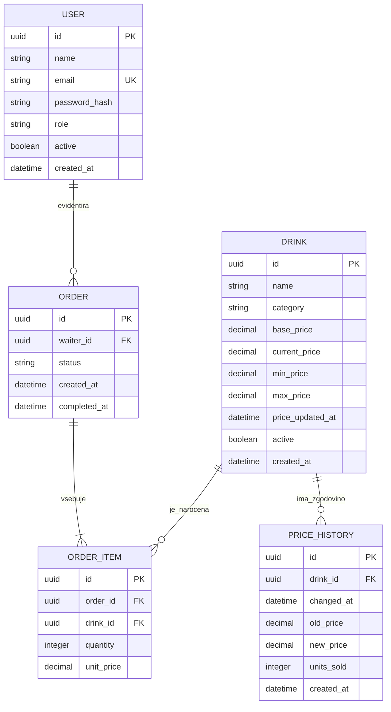

# 03 – Podatkovni model

## Podatkovna baza
Relacijska baza **PostgreSQL**. Primarni ključi so `UUID`, časovni žigi `TIMESTAMPTZ` (UTC), denarne vrednosti `NUMERIC(10,2)` (ne `FLOAT`).

## Entitete in glavna polja

| Entiteta | Polja | Namen |
|---|---|---|
| **User** | `id` PK, `name`, `email` UNIQUE, `password_hash`, `role` (`WAITER`, `MANAGER`), `active`, `created_at` | Zaposleni s prijavo; gost je anonimen. |
| **Drink** | `id` PK, `name`, `category`, `base_price`, `current_price`, `min_price`, `max_price`, `active`, `created_at` | Ponudba pijač z omejitvami cen. |
| **Order** | `id` PK, `waiter_id` FK → User, `status` (`OPEN`, `COMPLETED`, `CANCELLED`), `created_at`, `completed_at` NULL | Naročilo, ki ga evidentira natakar. |
| **OrderItem** | `id` PK, `order_id` FK → Order, `drink_id` FK → Drink, `quantity`, `unit_price`, `created_at` | Postavka naročila z zaklenjeno ceno ob dodajanju. |
| **PriceHistory** | `id` PK, `drink_id` FK → Drink, `changed_at`, `old_price`, `new_price`, `units_sold`, `created_at` | Zapis spremembe cene: prodaja (`units_sold > 0`) ali ohlajanje (`units_sold = 0`). |

## Povezave
- **User 1 : N Order** – en natakar lahko vnese več naročil; vsako naročilo ima natakarja.
- **Order 1 : N OrderItem** – naročilo vsebuje vsaj eno postavko pred zaključkom.
- **Drink 1 : N OrderItem** – ista pijača je lahko v številnih naročilih.
- **Drink 1 : N PriceHistory** – za vsako pijačo se beležijo izračuni in spremembe cen.

## Mermaid ER-diagram



## Integritetna pravila
- `quantity > 0`; `base_price > 0`; `min_price > 0`; `min_price <= base_price <= max_price`; `min_price <= current_price <= max_price`.
- `unit_price` se ob dodajanju postavke prekopira iz `Drink.current_price`; poznejše spremembe cene ne vplivajo na naročilo.
- `Order.completed_at` se določi ob prehodu v `COMPLETED`. Samo status `COMPLETED` vpliva na prodano količino.
- `Drink.price_updated_at` je trenutek zadnje spremembe cene; ohlajanje se računa iz časa, ki je pretekel od njega, zato ponovni zagon opravila cene ne zniža dvakrat.
- Dvig cene in zapis v `PriceHistory` potekata v isti transakciji kot zaključek naročila; vrstice pijač so pri tem zaklenjene, da se hkratne prodaje seštejejo.
- Indeks `(drink_id, changed_at)` v `PriceHistory` podpira poizvedbe za graf in trend.
- Naročil, postavk in zapisov zgodovine ne brišemo fizično; pijačo lahko označimo kot neaktivno, da ostanejo zgodovinski podatki pravilni.

## Primer poizvedbe za trend na ceniku

```sql
SELECT DISTINCT ON (drink_id) drink_id, old_price AS price_5_min_ago
FROM price_history
WHERE changed_at >= now() - interval '5 minutes'
ORDER BY drink_id, changed_at;
```

Stara cena prve spremembe v oknu je cena na začetku okna. Za pijače brez vrnjene vrstice se cena v zadnjih 5 minutah ni spremenila.
