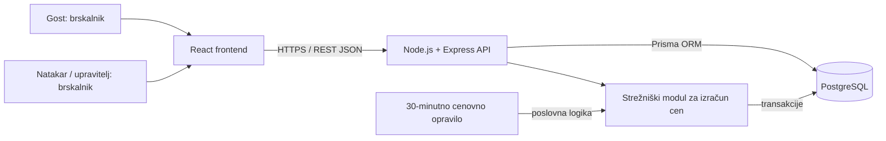

# 04 – Arhitektura in tehnološki sklad

## Pregled arhitekture
Aplikacija uporablja **odjemalec–strežnik**: React izriše strani za goste in zaposlene, Express API obdeluje poslovna pravila ter dostopa do PostgreSQL. Na strežniku teče tudi razporejeno opravilo za preračun cen. Odjemalec ne dostopa neposredno do podatkovne baze.



## Glavni deli sistema in komunikacija
1. **Frontend:** javni cenik, prikaz trenda in zgodovine ter zaščitene strani za natakarja in upravitelja. API kliče z `fetch` prek HTTPS, odgovor je JSON. Javni cenik podatke ponovno pridobi približno vsako minuto.
2. **Backend:** REST API z validacijo vhodnih podatkov, preverjanjem prijave in vlog ter upravljanjem naročil. Cena postavke se določi na strežniku, nikoli iz vrednosti, ki jo pošlje odjemalec.
3. **Podatkovna baza:** PostgreSQL hrani uporabnike, pijače, naročila, postavke in zgodovino cen. Prisma skrbi za migracije in poizvedbe.
4. **Razporejeno opravilo:** `node-cron` sproži izračun na mejah 30-minutnih intervalov. Opravilo obdeluje predhodno zaključeno obdobje. V MVP teče samo **ena** instanca backenda; transakcija in enolični ključ preprečujeta ponovno obdelavo obdobja.

## Osnutek API

| Metoda in pot | Dostop | Naloga |
|---|---|---|
| `GET /api/drinks` | javno | Trenutni cenik in spremembe cen. |
| `GET /api/drinks/:id/history` | javno | Zgodovina cen izbrane pijače (24 ur). |
| `POST /api/auth/login` | javno | Prijava zaposlenega. |
| `POST /api/auth/logout` | prijavljen | Odjava. |
| `POST /api/orders` | natakar, upravitelj | Ustvari odprto naročilo. |
| `POST /api/orders/:id/items` | natakar (lastna naročila), upravitelj | Doda postavko z veljavno ceno. |
| `PATCH /api/orders/:id/status` | natakar (lastna naročila), upravitelj | Zaključi ali prekliče naročilo. |
| `GET /api/orders` | natakar (lastna), upravitelj (vsa) | Pregled naročil. |
| `POST /api/drinks` | upravitelj | Doda pijačo z omejitvami cen. |
| `PATCH /api/drinks/:id` | upravitelj | Posodobi ponudbo in cenovne omejitve. |

Vsa preverjanja pravic in poslovna pravila se izvajajo v backendu; prikaz skritih gumbov v frontendu ni varnostni mehanizem.

## Avtentikacija in upravljanje uporabnikov
- Prijava zaposlenih z e-pošto in geslom; gesla se shranjujejo kot **Argon2id hash**.
- Po prijavi strežnik nastavi podpisan oziroma z naključno vrednostjo ustvarjen **sejni identifikator** v piškotku `HttpOnly`, `SameSite=Lax` in v produkciji `Secure`; seja je shranjena na strežniku (npr. v PostgreSQL).
- API preveri sejo in vlogo (`WAITER` ali `MANAGER`) pred vsako zaščiteno operacijo. Za zahteve, ki spreminjajo podatke, se uporablja zaščita pred CSRF.
- Gost uporablja samo javne poti in se ne prijavlja. Prvega upravitelja ustvari začetni skript; javne registracije ni.

## Tehnološki sklad

| Del | Tehnologije / orodja | Uporaba |
|---|---|---|
| Frontend | **React + Vite + TypeScript** | Odziven uporabniški vmesnik. |
| Backend | **Node.js + Express + TypeScript** | REST API, preverjanje pravic, poslovna pravila. |
| Podatkovna baza | **PostgreSQL** | Trajna hramba relacijskih podatkov. |
| Dostop do podatkov | **Prisma ORM** | Shema, migracije, transakcije. |
| Avtentikacija | **express-session, Argon2id** | Seje zaposlenih in varno hranjenje gesel. |
| Opravila | **node-cron** | Periodični izračun cen. |
| Grafi | **Recharts** | Vizualizacija gibanja cen. |
| Lokalni razvoj | **Docker Compose, npm, Git, VS Code** | Baza v vsebniku, lokalni razvoj aplikacije. |
| Testiranje | **Vitest + Supertest** | Enotski in API-testi. |

## Lokalni zagon (predviden za implementacijo)
1. Namestimo **Node.js LTS**, **npm**, **Docker** in **Docker Compose**.
2. V korenu projekta zaženemo `docker compose up -d` za PostgreSQL.
3. Datoteko `.env.example` kopiramo v `.env` in nastavimo `DATABASE_URL` ter `SESSION_SECRET`.
4. V mapi `backend/` zaženemo `npm install`, `npx prisma migrate dev`, začetni skript `npm run seed` in `npm run dev`.
5. V mapi `frontend/` zaženemo `npm install` in `npm run dev`.
6. V brskalniku odpremo naslov, ki ga izpiše Vite (običajno `http://localhost:5173`); backend je na primer na `http://localhost:3000`.

Predvidena struktura implementacije:

```text
DrinkExchange/
  frontend/             # React aplikacija
  backend/              # Express API, modul cen, opravilo, Prisma
  docs/                 # projektna dokumentacija
  docker-compose.yml    # PostgreSQL za lokalni razvoj
  .env.example          # primer okoljskih spremenljivk
```

## Ključne arhitekturne odločitve
- **React + REST API** ([ADR-0001](adr/0001-locen-react-frontend-in-rest-api.md)): ločitev uporabniškega vmesnika od poslovnih pravil; cenovna pravila so enotna za vse odjemalce.
- **PostgreSQL** ([ADR-0002](adr/0002-relacijska-baza-postgresql.md)): relacije med naročili, postavkami in pijačami ter transakcije zmanjšajo tveganje za nepravilne cene.
- **Zaklenjena cena postavke** ([ADR-0003](adr/0003-zaklenjena-cena-postavke.md)): naročilo obdrži ceno, veljavno ob dodajanju, tudi če se pozneje spremeni borzna cena.
- **Strežniški cenovni algoritem** ([ADR-0004](adr/0004-strezniski-izracun-cen-s-periodicnim-opravilom.md)): prepreči, da bi odjemalec sam določal obračunske cene ali povpraševanje.
- **Seje in RBAC** ([ADR-0005](adr/0005-seje-v-piskotkih-in-rbac.md)): javna registracija ni potrebna; vloge zaposlenih se preverjajo centralno na strežniku.
- **En sam backend v MVP** ([ADR-0006](adr/0006-ena-instanca-backenda-v-mvp.md)): poenostavi časovno opravilo; pri kasnejšem skaliranju se opravilo loči v samostojen proces z zaklepanjem v bazi.
- **Periodično osveževanje cenika** ([ADR-0007](adr/0007-periodicno-osvezevanje-cenika.md)): pri spremembah na 30 minut zadošča poizvedovanje vsako minuto; WebSocket je predviden kot kasnejša nadgradnja.

Podrobna utemeljitev, alternative in posledice so v [`adr/`](adr/).

## Osnovni testi
- Algoritem zviša ceno za 5 % pri 5 ali več prodanih enotah in zniža za 5 % pri nič prodanih enotah.
- Cena nikoli ne preseže `min_price` oziroma `max_price`.
- Preklicana in odprta naročila ne vplivajo na izračun.
- Ponovna obdelava istega časovnega intervala ne spremeni cene še enkrat.
- Gost ne more ustvariti naročila; natakar ne more spreminjati cenovnih pravil.
